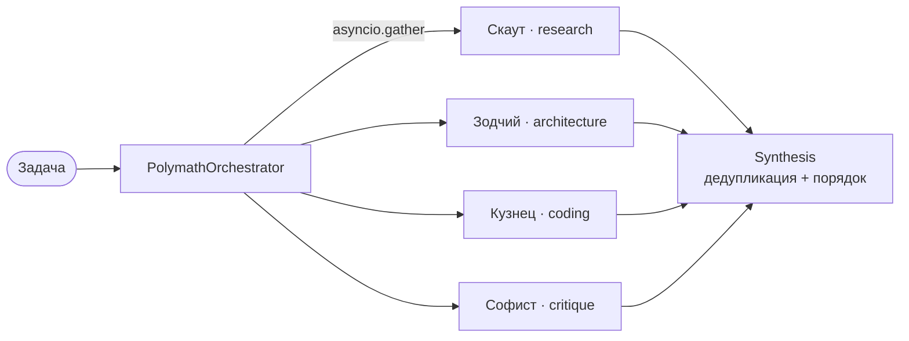

# 🧠 POLYMATH = MULTIAGENT

[](https://github.com/rtynbirf/polymath-multiagent/actions/workflows/ci.yml)
[](https://www.python.org)
[](LICENSE)
[](https://github.com/astral-sh/ruff)


> **Одно другое не исключает.**
> *Skills complement — never exclude.*

**polymath-multiagent** — микро-оркестратор параллельных ИИ-агентов, в котором философия
зашита прямо в код: агенты с разными навыками работают **одновременно**, дополняют
друг друга и физически не могут дублировать навыки друг друга. Пока другие фреймворки
строят иерархии и очереди — Полимат выпускает всех на поле сразу.

---

## ⚡ Почему такого нет ни у кого

1. **Контракт уникальных навыков.** Попытка собрать команду из двух агентов с одним
   и тем же навыком падает с `DuplicateSkillError` ещё до старта. Мотто проекта —
   не лозунг, а проверяемый инвариант (см. тесты).
2. **Параллельность по умолчанию.** Все агенты стартуют строго одновременно через
   `asyncio.gather`: общее время ≈ времени самого медленного агента, а не сумме
   времён. В демо: **0.70s вместо 1.90s** при 4 агентах.
3. **Синтез, а не свалка.** Находки агентов дедуплицируются с сохранением порядка
   первых вхождений — результат читается как единый документ, а не как лог чата.

## 🗺️ Архитектура



## 🚀 Быстрый старт

```bash
git clone https://github.com/rtynbirf/polymath-multiagent.git
cd polymath-multiagent
python -m pip install -e ".[dev]"
polymath demo        # живая демонстрация параллельной оркестрации
```

Требуется Python **3.10+**. Ноль внешних зависимостей в рантайме — только стандартная библиотека.

## 🎬 Живое демо (`polymath demo`)

```text
Мотто: Одно другое не исключает.
------------------------------------------------------------
[Скаут] (research, 0.30s)
  + Разведка: собран контекст по «построить уникальный проект»
  + Разведка: мировые аналоги найдены и проанализированы
[Зодчий] (architecture, 0.50s)
  + Архитектура: схема из 3 модулей для «построить уникальный проект» готова
[Кузнец] (coding, 0.70s)
  + Код: каркас «построить уникальный проект» собран
  + Код: тесты написаны и зелёные
[Софист] (critique, 0.40s)
  + Критика: риски под контролем
  + Критика: «построить уникальный проект» жизнеспособен
------------------------------------------------------------
Задача: построить уникальный проект
Агентов: 4 | Уникальных навыков: 4
Время (параллельно): 0.70s вместо 1.90s (экономия 1.20s)
```

## 🔒 Контракт уникальных навыков

```python
from polymath import Agent, DuplicateSkillError, PolymathOrchestrator

try:
    PolymathOrchestrator([Agent("Альфа", "research", act=...),
                          Agent("Бета", "research", act=...)])
except DuplicateSkillError as e:
    print(e)  # Навыки должны дополнять друг друга... Повторяются: research
```

Свой агент — это три поля: имя, навык и асинхронная функция `act(task) -> list[str]`.
Никаких базовых классов, никаких конфигов на 200 строк.

## ✅ Тесты и CI

```bash
pytest -q      # 19 тестов: контракт навыков, параллельность, синтез, MCP, SSE
ruff check .   # чистота кода
```

GitHub Actions гоняет матрицу Python 3.10 → 3.13 на каждый push.

## 🔌 MCP-сервер · v0.2

Полимат теперь — **инструмент для любых LLM-хостов**: Claude Desktop, IDE-агенты и любой
MCP-клиент оркестрируют экипаж, не устанавливая ничего сверх протокола.

```bash
pip install "polymath-multiagent[mcp]"
```

Конфигурация MCP-хоста:

```json
{
  "mcpServers": {
    "polymath": { "command": "polymath", "args": ["mcp"] }
  }
}
```

| Инструмент / ресурс | Что даёт |
|---|---|
| `polymath_info` | паспорт: версия, мотто, состав экипажа |
| `orchestrate(task)` | параллельный прогон 4 агентов + измеренный выигрыш времени |
| `polymath://motto` | мотто проекта одной строкой |
| `polymath://skills` | уникальные навыки экипажа |

Проверка без внешних хостов: `fastmcp.Client` подключается к серверу прямо в памяти —
этими тестами CI и живёт (`tests/test_mcp_server.py`).

## 📊 Живой дашборд оркестрации

```bash
polymath dashboard --port 8765   # открыть http://127.0.0.1:8765
```

Экипаж живёт в фоне бесконечными циклами оркестрации; события агент-за-агентом летят
в браузер по **Server-Sent Events**. Ноль зависимостей — чистый stdlib:
`http.server` + `asyncio` + одна шина событий.

- 🔴 карточка агента пульсирует, пока он работает, и зеленеет, когда закончил
- 💰 панель «СИНТЕЗ» считает экономию времени от параллельности в реальном времени
- 📜 журнал событий внизу — каждый цикл, каждый агент

## 🗺️ Дорожная карта

| Фаза | Что будет |
|------|-----------|
| v0.2 | ✅ **MCP-сервер** — Полимат как инструменты для любых LLM-хостов |
| v0.3 | ✅ **Живой дашборд** — SSE-оркестрация в браузере, stdlib-only |
| v0.4 | Распределённый режим: агенты в разных процессах/на разных машинах |
| v0.5 | Опциональные LLM-провайдеры внутри агентов |

## 🇬🇧 English in one paragraph

**polymath-multiagent** is a zero-dependency micro-orchestrator for parallel AI agents.
Its philosophy is enforced in code: agents with unique skills run **simultaneously**
(`asyncio.gather`), duplicate skills are rejected at construction time with
`DuplicateSkillError`, and findings are merged into a deduplicated, order-preserving
`Synthesis`. v0.2 ships an **MCP server** (`pip install "polymath-multiagent[mcp]"` —
usable from Claude Desktop and any MCP host) and a **live SSE dashboard**
(`polymath dashboard`) with zero runtime dependencies. Install with
`pip install -e ".[dev]"`, run `polymath demo`, and watch four agents finish in the
time of the slowest one.

## 📄 Лицензия

[MIT](LICENSE) — **rtynbirf · Полимат-Универсум** · 2026
